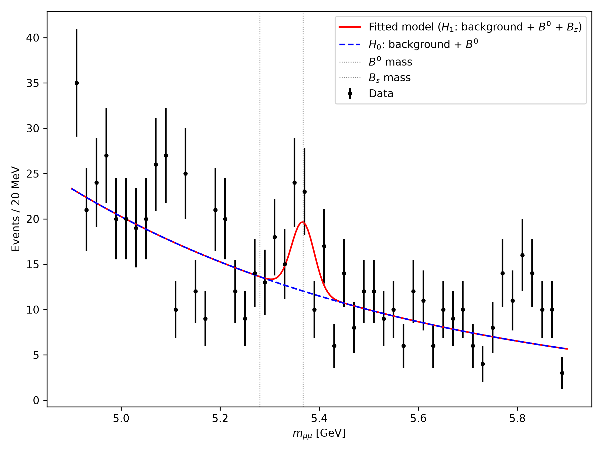

# Search for $B_s \to \mu^+\mu^-$

A group exercise of *Advanced Computational Physics* (USC): **2 hours, groups of 4**. It
puts together numpy, pandas, scipy, classes, functional programming and git.

## The physics

The decay $B_s \to \mu^+\mu^-$ is very rare in the Standard Model (a branching fraction of
about $3.6 \times 10^{-9}$), and therefore sensitive to new physics. LHCb, with the
participation of the IGFAE, found the first evidence for it in 2012, and observed it
together with CMS in 2015. You get (synthetic) LHCb
data: muon pairs. In their invariant mass you should find a small $B_s$ peak at
5366.9 MeV, a smaller $B^0$ peak at 5279.7 MeV, and a large background that falls
exponentially.

There is a catch: the momenta of the muons are **miscalibrated**, by a different amount
in each region of the detector. The $B_s$ and $B^0$ masses differ by 1.6 %: a
miscalibration of that size moves one peak onto the other. To calibrate, use the J/ψ
(3096.9 MeV), whose mass is well known and whose peak is large.

## What you get

| File | What it is |
|:--|:--|
| `data/bsmumu.h5` | the data; keys `groupN/control` (J/ψ region) and `groupN/search` (B region) |
| `mc.py` | the Monte Carlo: same format as the data, **perfectly calibrated** |
| `dimuon.py`, `calibration.py`, `search.py` | the modules you complete (`TODO`) |
| `calibration.ipynb`, `analysis.ipynb` | the notebooks: they only **call** the modules |
| `calibration.json` | the calibration, dummy for now (scales 1) |
| `test_*.py` | the tests your code must pass: `pytest` |
| `_generator.py`, `_kinematics.py` | internal to the MC: do not edit |

Each row of the data is a muon pair:

| Column | Meaning |
|:--|:--|
| `mu1_pt`, `mu1_eta`, `mu1_phi` | transverse momentum (GeV), pseudorapidity and azimuth of muon 1 |
| `mu2_pt`, `mu2_eta`, `mu2_phi` | the same for muon 2 |
| `mu1_q`, `mu2_q` | electric charge of each muon: +1 or −1 |
| `mu1_pid`, `mu2_pid` | probability that the particle is a muon (0 to 1) |
| `vtx_chi2` | $\chi^2$ of the common vertex of the two muons (small: they come from one decay) |
| `trigger` | the event was selected online by the dimuon trigger line: it keeps most of the signal and only part of the background |

Some values are missing (NaN): the reconstruction failed.

Each group has its own data. **Your teacher gives you your group number** (1 to 8): set
`GROUP` in both notebooks, which then read the keys `group{GROUP}/control` and
`group{GROUP}/search`.

The MC: `df, truth = mc.generate('search', seed=1)` gives a sample with a random number of
$B^0$ and $B_s$ decays, returned in `truth`. `mc.generate('control')` gives a J/ψ sample.
`n_bkg=0` gives signal only.

## The invariant mass

For each muon, with $m_\mu = 105.66$ MeV:

$$\vec p = p_T\,(\cos\phi,\ \sin\phi,\ \sinh\eta), \qquad E = \sqrt{|\vec p|^2 + m_\mu^2}$$

and for the pair

$$m_{\mu\mu}^2 = (E_1 + E_2)^2 - |\vec p_1 + \vec p_2|^2 .$$

## The calibration

The measured transverse momentum of a muon is $p_T^{\text{meas}} = s_r\, p_T$, where the
scale $s_r$ depends on the region of the muon: `low` ($\eta < 3.5$) or `high`
($\eta \geq 3.5$). For a pair, $m^{\text{meas}} \approx \sqrt{s_{r_1} s_{r_2}}\; m$.

1. Take the J/ψ events with **both muons in the same region**: their peak is at
   $s_r\, m_{J/\psi}$. Fit it: $s_r = m_{\text{peak}} / m_{J/\psi}$.
2. Correct **each muon**: divide its $p_T$ by the scale of its region, then recompute
   the mass.
3. Check with the events with one muon in each region, not used in the fit.

## The search

Histogram of the mass from 4.9 to 5.9 GeV, in 20 MeV bins. The model (`search.model`):
an exponential background plus two Gaussian peaks at the $B^0$ and $B_s$ masses, of a
common width $\sigma$ that you measure on the MC and keep fixed.

* $H_1$: background + $B^0$ + $B_s$; $H_0$: background + $B^0$ (no $B_s$).
* Fit both with `curve_fit` ($\sigma_i = \sqrt{n_i}$ in each bin) and compute
  $\Delta\chi^2 = \chi^2_{H_0} - \chi^2_{H_1}$.
* p-value: `scipy.stats.chi2.sf(Δχ², df=1)`; significance $\sqrt{\Delta\chi^2}$ sigmas.

## Who does what

A, B, C and D are the four members of the group: decide who is who in the first minutes.
A and B form the calibration team, C and D the analysis team.

| | Task | Module | Tests |
|:--|:--|:--|:--|
| **A** | `invariant_mass`, vectorised with numpy | `dimuon.py` | `test_dimuon.py` |
| **C** | the cuts (opposite charges, muon identification, vertex) and `select` (functions combined with `functools.reduce`) | `dimuon.py` | `test_dimuon.py` |
| **B** | `fit_peak`, `Calibration.apply` and `Calibration.fit`; `calibration.ipynb` | `calibration.py` | `test_calibration.py` |
| **D** | `search.fit` and `search.pvalue`; `analysis.ipynb` | `search.py` | `test_search.py` |

A and C go first (about 30 min): B and D need their functions. Meanwhile B and D write
their fits and try them on toy arrays made with numpy. Then A helps B (the check with the
mixed events) and C helps D (the closure test and the figure).

**The interface.** `Calibration.load().apply(df)` is the contract between the two teams.
Until B's pull request arrives, `apply` returns the data unchanged and `calibration.json`
holds scales 1: the analysis runs on the MC. When it arrives, D sets `USE_DATA = True`.
That is the whole swap.

## Git

1. One of you creates the group repository: on the GitHub page of this template,
   **Use this template → Create a new repository**. Name it after your group number,
   e.g. `bsmumu-group3`. Then add the other three as **collaborators** (Settings →
   Collaborators). Each of them must accept the invitation (by email, or in the GitHub
   notifications) before they can push.
2. Everyone clones it. Each task on its **own branch**: `git switch -c mass`.
3. When the tests of your part pass, push the branch and open a **pull request**.
4. Someone **from the other team** reviews it, then merges it. After a merge, everyone
   runs `git pull` on `main`. If you work on a branch and need what was just merged (B
   and D need the mass and the selection), bring `main` into your branch:
   `git switch main && git pull && git switch calibration && git merge main`.
5. Each notebook has one owner: only B edits `calibration.ipynb`, only D
   `analysis.ipynb`. Two people editing the same notebook make conflicts that are hard
   to resolve. Code goes in the modules, not in the notebooks.

## Timeline

| Minutes | Calibration (A, B) | Analysis (C, D) |
|:--|:--|:--|
| 0–15 | repository, clone, branches | the same |
| 15–45 | A: mass → PR. B: `fit_peak` on toy data | C: `select` → PR. D: `fit` on toy data |
| 45–60 | review and merge the PRs of A and C; `git pull` | the same |
| 60–85 | B: fit on MC (scales ≈ 1), then on data → PR with `calibration.json` | D: MC closure test, p-value on MC |
| 85–105 | A: check with the mixed events | D: `USE_DATA = True`, fit, p-value. C: figure |
| 105–120 | README: results and figure; final PR | the same |

## Extra: the same-sign pairs

A $B_s$ decays into $\mu^+\mu^-$: the signal pairs have opposite charges. The background
pairs are combinations of unrelated muons, so about half of them have the same sign. The
same-sign pairs that pass all the other cuts are therefore a sample of pure background.
Fit their mass spectrum with the exponential alone: is the slope compatible with the one
of the opposite-sign fit?

## For the discussion

The data have one row per **event**, with the columns of the two muons side by side
(`mu1_...`, `mu2_...`): the *wide* format. The alternative is one row per **muon**, with
columns `event`, `pt`, `eta`, `phi`, `q`, `pid`: the *long* format, and `groupby('event')`.
Which one would have been more convenient? Think of the invariant mass, of cuts on each
muon and on the event, and of events with more than two muons.

## Deliverable

At the end of the session, your repository with:

* the modules completed, and `pytest` passing;
* `calibration.json` with your scales;
* the two notebooks run, with their outputs;
* this README completed with a **Results** section: the two scales, $n_{B^0}$ and
  $n_{B_s}$ with errors, the p-value and its significance, and the figure
  `search_fit.png`;
* a history with one pull request per task, each reviewed by someone else.

## Results

Group 1.

| | |
|:--|:--|
| Scale `low` ($\eta < 3.5$) | 0.9909 ± 0.0002 |
| Scale `high` ($\eta \geq 3.5$) | 0.9753 ± 0.0002 |
| $n_{B^0}$ | 0.0 ± 7.7 |
| $n_{B_s}$ | 21.9 ± 9.0 |
| p-value | 0.015 |
| Significance | 2.4σ |

